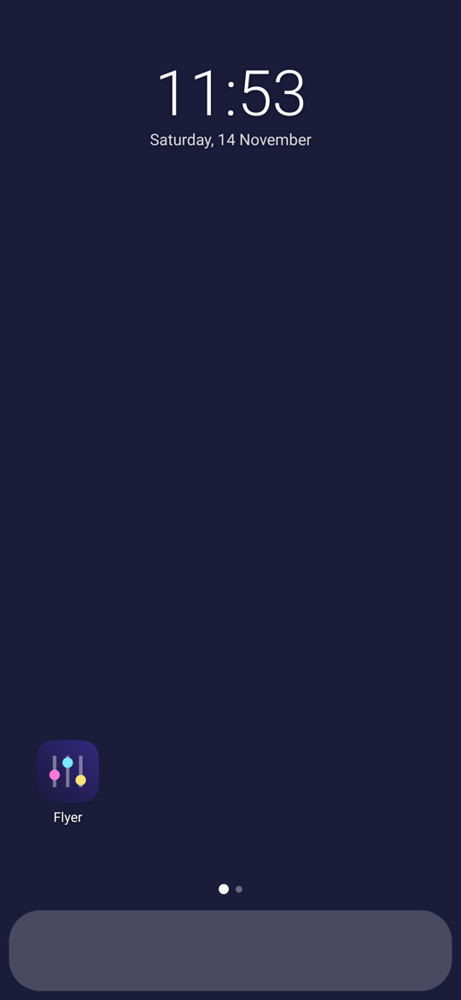
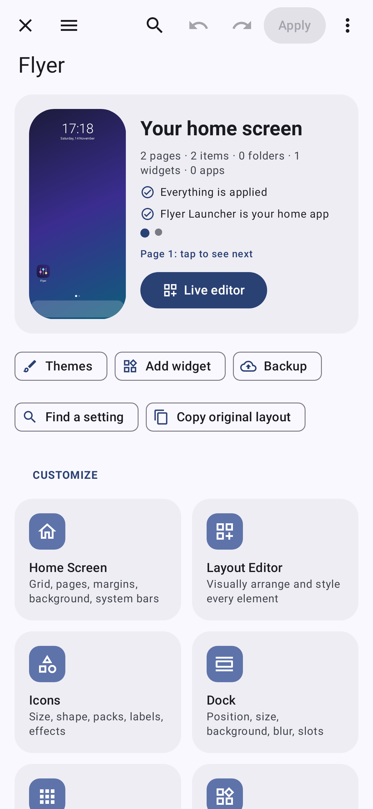
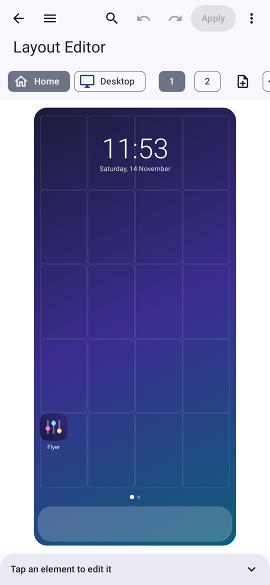
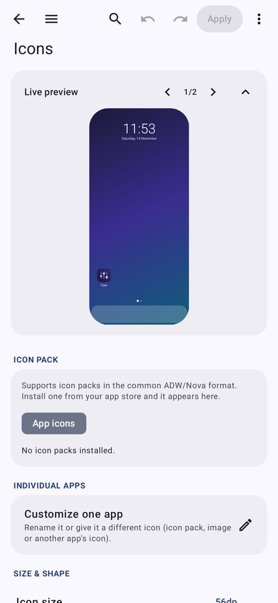
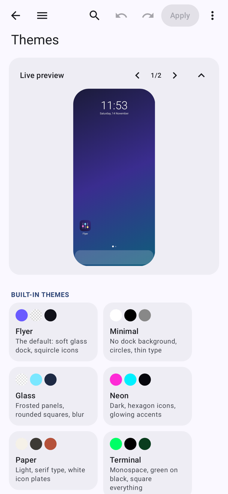
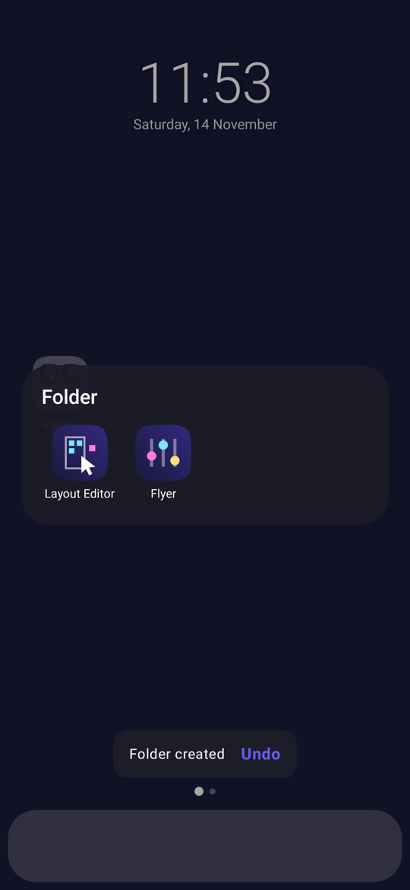
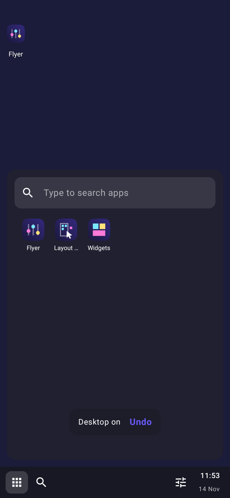
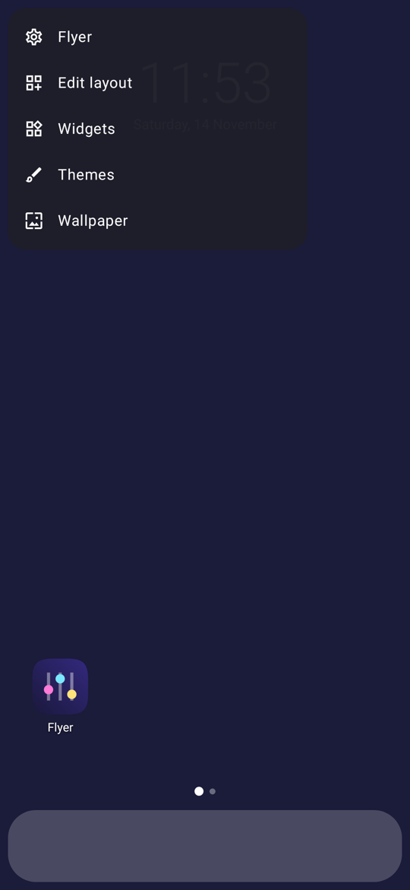

# Flyer Launcher

An Android home-screen launcher whose built-in customization environment, **Flyer**, controls everything the launcher owns: grid, icons, dock, drawer, folders, widgets, gestures, animations, appearance, typography and a desktop mode. Flyer also includes a visual live editor, themes, and backup and restore.

Flyer is **not** a separate app or a second launcher. It is a subsystem of the launcher and opens inside the launcher's own (and only) HOME activity. It shows up as the built-in **Flyer** app icon on the home screen and in the app drawer.

| Home | Flyer dashboard | Live editor | Icons module |
|---|---|---|---|
|  |  |  |  |

| Themes | Folder (made by drag & drop) | Desktop mode | Home menu |
|---|---|---|---|
|  |  |  |  |

*These screenshots are rendered by the Robolectric UI tests, so there is no system wallpaper and no installed apps, only the built-in ones.*

---

## Install

Download **`dist/FlyerLauncher-1.0.1.apk`**. It needs Android 8.0 (API 26) or newer, and you have two options:

| File | Use it when |
|---|---|
| `FlyerLauncher-1.0.1.apk` | **Recommended.** The standard build: no accessibility service and no "see all apps" permission, so Play Protect doesn't block it. |
| `FlyerLauncher-1.0.1-full.apk` | You also want the *Lock screen*, *Recent apps* and *Screenshot* gestures. These need an accessibility helper, and Play Protect blocks most sideloaded apps that include one. |

1. Open the APK on the phone, or run `adb install dist/FlyerLauncher-1.0.1.apk`.
2. **If Play Protect shows a warning** (normal for any app that isn't from the Play Store):
   * Tap **More details → Install anyway**.
   * If the dialog has no "Install anyway" button: open the **Play Store → your profile picture → Play Protect → ⚙ settings**, turn off **Scan apps with Play Protect**, install the APK, then turn scanning back on.
   * If your browser or file manager isn't allowed to install apps, Android shows a prompt. Allow **Install unknown apps** for it.
3. Make it the default home app, using any one of these:
   * Press the **Home** button. If Android asks, choose **Flyer Launcher** and then **Always**.
   * Open **Settings → Apps → Default apps → Home app → Flyer Launcher**. The exact wording varies by manufacturer.
   * Open Flyer Launcher from your current launcher (it has a normal app icon), then tap **Flyer → Set as default** on the dashboard. On Android 10+ this uses the system "Home app" role dialog.
4. Full build only: enable **Settings → Accessibility → Flyer Launcher gestures**. On Android 13+ you may first need **App info → ⋮ → Allow restricted settings**.

The standard and full builds are signed with the same key, so you can switch between them without uninstalling. A build you compile yourself with a different key needs an uninstall first, so export your setup in **Flyer → Backup & Restore** beforehand.

## Opening Flyer

There are several ways in, and they are deliberately redundant:

* Tap the **Flyer** icon on the home screen or in the drawer.
* Long-press empty home space and pick **Flyer** from the home menu. This entry cannot be removed.
* Use the two-finger swipe up gesture (default binding), or pinch in to open the **Layout Editor**.
* Search for any setting name in the launcher search.
* Use the keyboard: **Ctrl + ,** opens Flyer and **Ctrl + E** opens the editor.

Removing the Flyer shortcut never uninstalls or disables Flyer. **Flyer → Advanced → Built-in apps** restores it.

## Build

Requirements: JDK 17+ and Android SDK platform 36 (build-tools 35).

```bash
cd flyer-launcher
echo "sdk.dir=/path/to/Android/sdk" > local.properties
./gradlew assembleStandardRelease   # app/build/outputs/apk/standard/release/ (R8-minified, ~2 MB)
./gradlew assembleFullRelease       # same, plus the optional accessibility gesture helper
./gradlew assembleStandardDebug     # debug build (package com.flyer.launcher.debug)
./gradlew testStandardDebugUnitTest # 41 tests: engines + Robolectric UI tests (screenshots → app/build/flyer-screenshots)
```

Release builds are signed with the key described in `keystore.properties` (`storeFile`, `storePassword`, `keyAlias`, `keyPassword`; git-ignored). Without that file they fall back to your local debug key.

Build flavors: `standard` (default) ships no accessibility service. `full` adds `src/full`, the optional gesture helper, and `BuildConfig.GESTURE_HELPER` tells the UI which build it is running in.

Toolchain: Kotlin 2.2, Jetpack Compose (BOM 2025.10), Material 3, AGP 8.13, Gradle 8.14, kotlinx.serialization, DataStore, coroutines/Flow, AppWidgetHost/AppWidgetManager and LauncherApps. Room is not used: the persisted state is a single versioned document, which DataStore handles atomically.

---

## Architecture

```
Launcher Core  (core/LauncherCore.kt: one per process, owned by FlyerApp)
├── Workspace Engine     core/workspace     pure, unit-tested layout operations: placement, collisions,
│                                           folders, dock, pages, free positioning, LayoutValidator
├── App Discovery Engine core/apps          LauncherApps over every user profile, package callbacks,
│                                           launching, app shortcuts, built-in apps, icon packs, sorting/search
├── Widget Engine        core/widgets       AppWidgetHost, bind/configure/delete, size options, span limits,
│                                           long-press-aware host views
├── Gesture Engine       core/gestures      gesture→action bindings, system actions, optional accessibility helper
├── Theme Engine         core/theme         color schemes (incl. Material You), fonts, motion specs, theme presets
├── Rendering Engine     core/render        icon shapes, adaptive/themed/legacy icon rendering, byte-bounded LRU cache
│                        launcher/render    grid geometry + shared visuals (tiles, folders, widgets, built-in widgets)
├── Persistence Engine   core/persistence   DataStore document, JSON codec, migrations, snapshots, media import
└── Flyer                flyer/             (talks to the launcher only through LauncherApi)
    ├── Dashboard            screens/DashboardScreen.kt
    ├── Layout Editor        editor/LiveEditorScreen.kt, editor/EditorCanvas.kt
    ├── Component Inspector  editor/Inspector.kt
    ├── Appearance editors   screens/CategoryScreen.kt + settings/SettingsRegistry.kt (generated controls)
    ├── Gesture Editor       screens/Modules.kt
    ├── Theme Manager        screens/Modules.kt
    ├── Preview Engine       preview/PreviewEngine.kt
    └── Backup & Restore     screens/Modules.kt
```

**A single source of truth.** Every visual or behavioural property lives in one immutable, versioned `FlyerConfig` (`core/config/FlyerConfig.kt`). The arrangement lives in `HomeLayout` (`core/model/LayoutModel.kt`). Launcher components hardcode no visual values; they read the config from the composition.

**Flyer edits a draft.** `FlyerSession` holds a draft document with a bounded undo/redo history. Slider drags are coalesced into a single undo step. Previews render the draft with the *same composables* the launcher uses, scaled down by `ScaledScreen`. **Apply** validates the draft and commits it through `LauncherApi.commit`. The "Apply changes instantly" option commits every edit as it happens.

**Settings are declarative.** Each of the roughly 200 settings is one `SettingSpec`: a lens into the config, plus control type, range, category, section, the editor elements it styles, its level (basic or advanced) and an optional limitation note. Category screens, settings search, the inspector, per-setting resets and per-category resets are all generated from `SettingsRegistry`. To add a module, add a `FlyerCategory` entry and its specs.

**Invalid configurations can't break the launcher:**
* `ConfigValidator` clamps every value.
* `LayoutValidator` repairs layouts: duplicate ids, items outside the grid, overlaps, one-app folders and dock overflow. Items are moved, never dropped.
* `DocumentCodec` decodes each config section on its own, so a corrupt section only resets that section. Unknown keys and enum values are tolerated.
* `ConfigMigrations` upgrades older schema versions.
* A corrupt file on disk is copied aside and the launcher starts fresh.
* Flyer always stays reachable: if the empty-space long press is bound to "nothing", the validator rebinds it to the home menu.

**Drag and drop works across all surfaces.** Items only *arm* a drag on long press. After that, a root-level pointer monitor (`DragController`) tracks the finger, so the drag survives the drawer or a folder closing underneath it. Drop zones resolve targets for pages, dock, desktop, taskbar and the Remove / App info / Hide / Uninstall bar. Supported actions include moving to a cell or free position, dropping an app onto an app to create a folder, adding to a folder, inserting into the dock, pinning to the taskbar, and holding at a screen edge to flip pages or create a new page.

## What each Flyer module controls

| Module | Highlights |
|---|---|
| Home Screen | Grid columns/rows, grid or free positioning (with snap step and optional overlap), fill or fixed cell height plus alignment, margins, spacing, pages (add, reorder, delete, default page), infinite scroll, page indicator style/color/position, background (system wallpaper with parallax, solid, gradient, or image with blur), dim scrim, status/navigation bar visibility and icon color, layout lock |
| Layout Editor | Live canvas of the real home screen and desktop. Select icons, folders, widgets, dock, indicator, search bar or workspace. Drag with grid snapping or free positioning with alignment guides, resize widgets within provider limits, add apps/folders/widgets, move between pages/dock/desktop, per-element inspector, reset element, undo/redo |
| Icons | Size, 9 shapes (incl. squircle, teardrop, hexagon, pebble, clover) with corner control, inset, reshaping legacy icons, themed monochrome icons (Android 13+), work-profile badges, opacity, saturation/grayscale, shadow, border, press effect, label style (show, color, size, weight, lines, shadow, uppercase, gap), ADW/Nova icon packs, per-app label and icon (pack icon, image, or another app's icon) |
| Dock | Show/hide, position (bottom/top/left/right), slots, alignment, spacing, icon size, labels, height, width (floating dock), margins, color, opacity, corner radius, backdrop blur, border, contents manager |
| App Drawer | Grid or list, columns, icon size, spacing, padding, labels, sort (A–Z, Z–A, most used, recently installed/updated), recent row, category tabs, your own groups as tabs, work-app tab, alphabet fast scroller, search placement and keyboard, background color/opacity/blur/corners, open animation, hidden apps |
| Widgets | Native AppWidgets (bind, configure, reconfigure, resize within limits, restore after import), container padding/corners/clipping/background, built-in launcher widgets: Clock (digital/stacked/analog, 24h, seconds, date format, color, size, weight), Date, Search bar, Flyer quick panel |
| Folders | Preview style, shape, color, opacity, popup or full screen, columns, visible rows, background/opacity/corners/blur, open animation, title and label styling, per-folder overrides (name, color, shape, preview, columns, app order) |
| Gestures | Swipe up/down, double tap, empty-space long press, pinch in/out, two-finger swipes, Home button while on home, swipe up on dock. Each maps to any of 18 actions (drawer, search, Flyer, editor, notifications, quick settings, lock, recents, screenshot, launch app, desktop toggle, theme toggle, page navigation, add widget). Sensitivity and haptics are adjustable |
| Animations | On/off, follow the system setting, duration scale, easing (incl. spring and bouncy), page transitions (slide, fade, depth, cube, stack, zoom, rotate), app-opening animation, press-shrink amount, home entrance animation |
| Appearance | Theme mode, Material You, accent color, high-contrast text, menu color/opacity, corner roundness |
| Typography | System/sans/serif/mono/condensed/medium fonts, or import your own .ttf/.otf, text scale, letter spacing, use the launcher font inside Flyer |
| Desktop Mode | Off / on / automatic (pointer device and ≥600 dp). Free-form desktop with draggable icons and widgets, taskbar (pins, clock, labels, position, color), start menu panel, folders as draggable windows, hover states, right-click menus, double-click option, keyboard shortcuts, auto-arrange. Desktop and mobile layouts are stored separately |
| Search | Home search bar position and style; sources: apps, app shortcuts, Flyer settings, web; fuzzy matching; result count |
| Themes | 7 built-in presets and your saved themes. Themes change looks only (never your arrangement or behaviour). Export/import theme files |
| Performance | Effects level (full/balanced/minimal), blur on/off, low-memory mode, icon cache size, icon render resolution, background icon prefetch, background widget updates, cache and usage reset. Low-RAM devices start in minimal mode |
| Advanced | Orientation, Home closes Flyer, apply instantly, advanced settings, removal confirmations, hidden apps in search, add new apps to home, undo history length, layout bounds overlay, default-home and accessibility helper status, built-in apps manager, rebuild layout, reset everything |
| Backup & Restore | Export or import a full setup as JSON (Storage Access Framework). Imports load as a reviewable draft. On-device snapshots |

## Android limitations, and what Flyer does instead

Flyer has full authority over what the launcher owns, and only that. It requests no root and touches no system partitions or other apps.

| Wanted | Platform reality | What Flyer does |
|---|---|---|
| Swipe down for notifications or quick settings | No public API | Calls `StatusBarManager.expand*Panel` (the long-standing launcher approach, using the normal `EXPAND_STATUS_BAR` permission). If that is unavailable, the full build falls back to the accessibility helper |
| Lock screen, recents, screenshot | Only accessibility services can trigger these, and Play Protect blocks sideloaded apps that include one | Available only in the **full** build, through the optional "Flyer Launcher gestures" helper. It performs only these global actions and reads no content. The standard build hides these actions |
| Seeing every installed app | `QUERY_ALL_PACKAGES` is a restricted permission | Not requested. Manifest `<queries>` for launcher activities, icon packs and widget providers cover everything a launcher needs |
| Blur behind dock or panels with the system wallpaper | Apps can't read or blur part of the system wallpaper | Window blur-behind for drawer and folders (Android 12+, when the device allows cross-window blur). Dock backdrop blur when the background is drawn by the launcher (Home Screen → Background) |
| Showing your real wallpaper in Flyer previews | Reading the wallpaper needs privileged access on modern Android | Uses the real image when allowed, otherwise a gradient built from the wallpaper's own colors |
| App shortcuts and "Add to home screen" pins | Only available to the **default** home app | Works automatically once Flyer Launcher is your default home app |
| Placing a widget | Android may ask once per provider for permission to bind | The standard system permission dialog is shown |
| Themed icons | Needs Android 13 and app-provided monochrome icons | Apps without one keep their normal icon |
| Custom app-opening animations | Android 12+ may substitute its own animation | The setting applies wherever the system honours it |
| Moving widgets between devices | Widget ids belong to one device | Imported widgets appear as "tap to restore" placeholders that re-bind the same provider |

## Tests

* **Engines** (`WorkspaceEngineTest`, `ConfigAndPersistenceTest`, `MiscLogicTest`): drag and drop rules, folders, dock, pages, validators, codec robustness, migrations, history coalescing, fuzzy search, grid geometry, widget resizing, settings-registry consistency, and checking that themes don't touch arrangement or behaviour.
* **UI** (`UiSmokeTest`, Robolectric with native graphics) launches the real HOME activity and:
  * renders home, drawer, search, the home menu, all 17 Flyer modules, the live editor, the app editor, the widget picker and desktop mode;
  * runs edit → undo → redo → apply;
  * performs a real long-press drag of an icon;
  * creates a folder by dropping one app onto another;
  * drags in the live editor and checks that only the draft changes.
